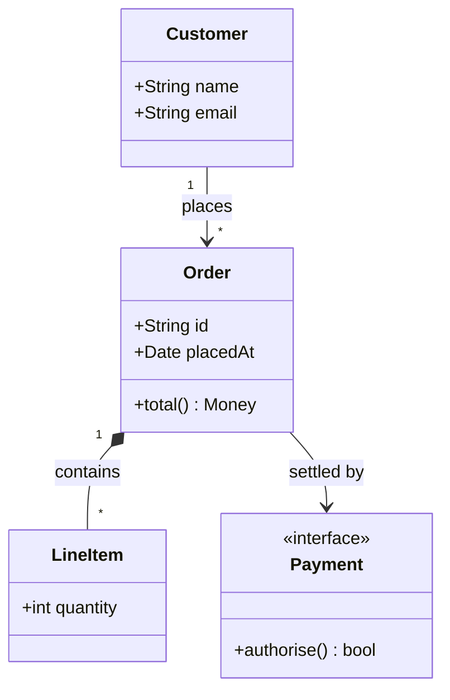
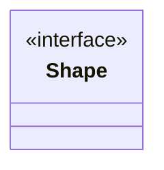
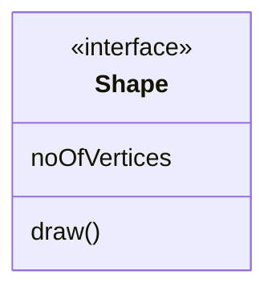
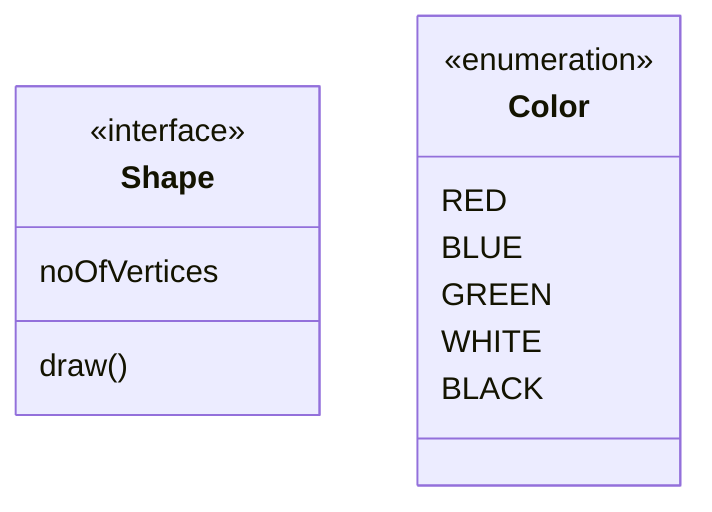
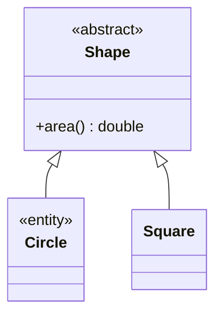
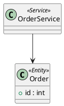

# class-annotations

UML annotations (`<<interface>>`, `<<enumeration>>`…) drawn as `«interface»` above the class name, the first one only, as Mermaid does. Mermaid 12.3.0 official examples, then an inheritance tree (SmartArt when on) and a PlantUML stereotype.

## classDiagram#1

## classDiagram#23

## classDiagram#24

## classDiagram#25

## classDiagram#26

## Inheritance tree with annotations

## PlantUML stereotype

