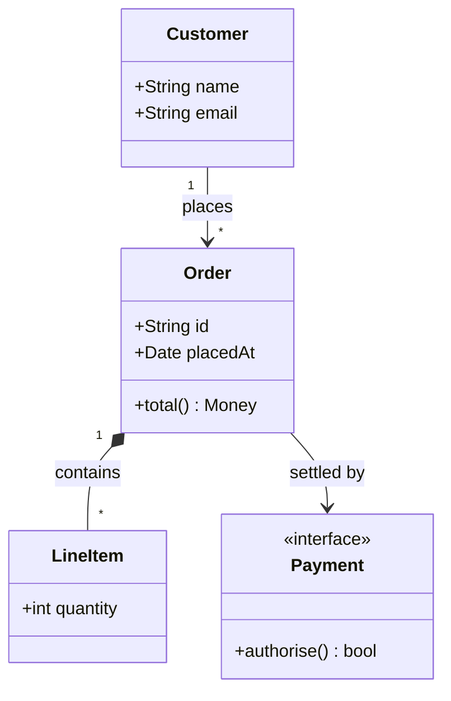
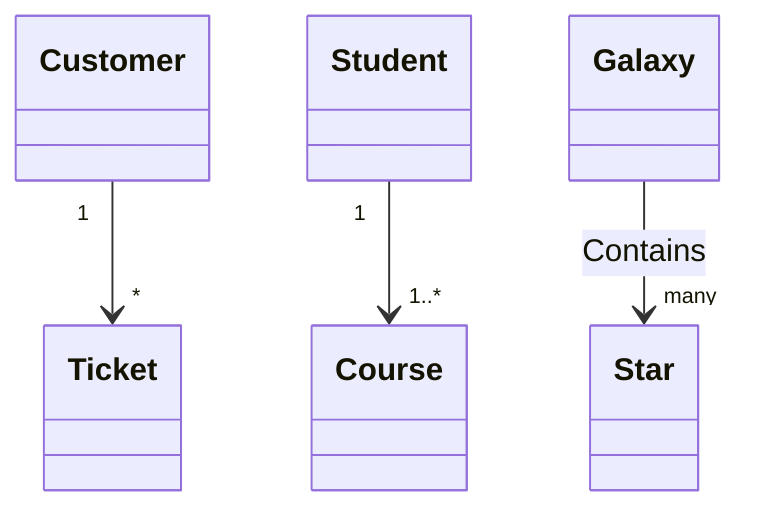
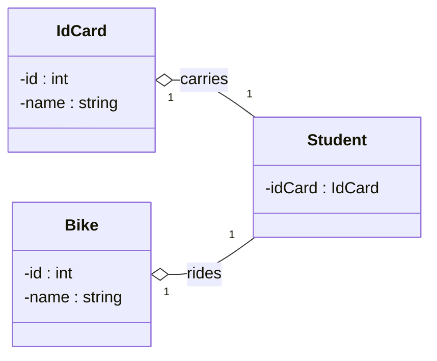
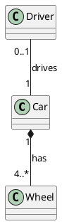

# class-cardinalities

Relation cardinalities (`A "1" --> "*" B`) drawn next to the end they are written beside, as Mermaid does. Mermaid 12.3.0 official examples, then a PlantUML relation.

## classDiagram#1

## classDiagram#22

## classDiagram#27

## PlantUML

