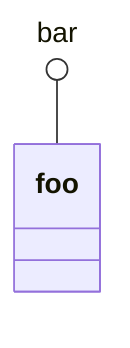
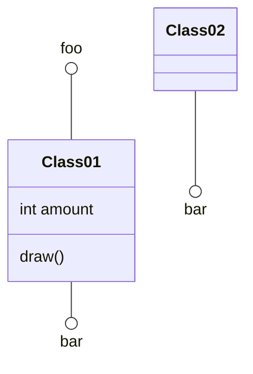

# class-lollipops

Provided interfaces (`Class --() name`, `name ()-- Class`): a hollow circle on a line from the class, its name beyond it, as Mermaid draws them. Mermaid 12.3.0 official examples.

## classDiagram#15

## classDiagram#16

