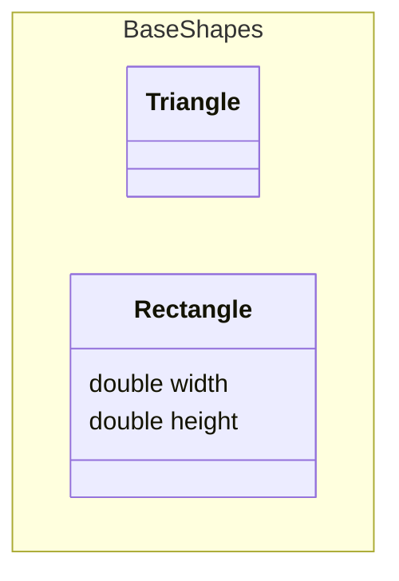
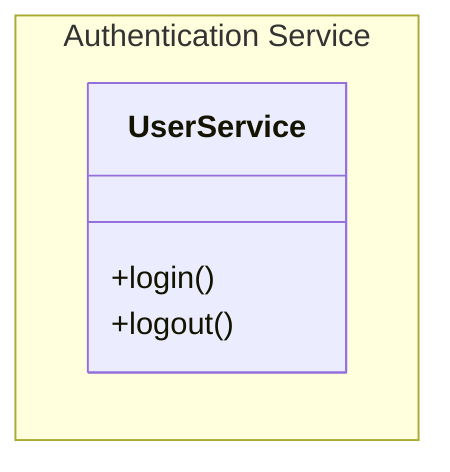
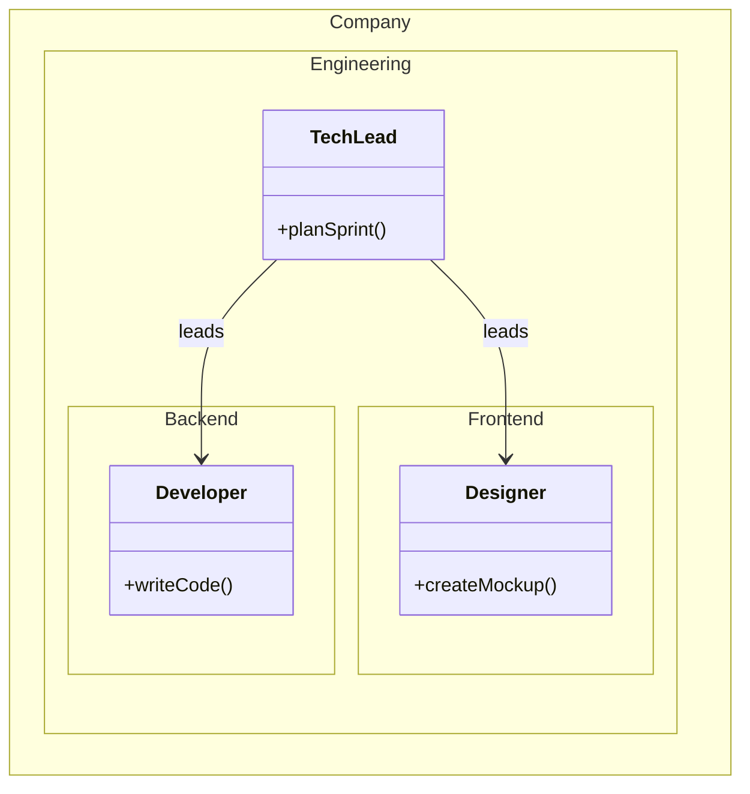
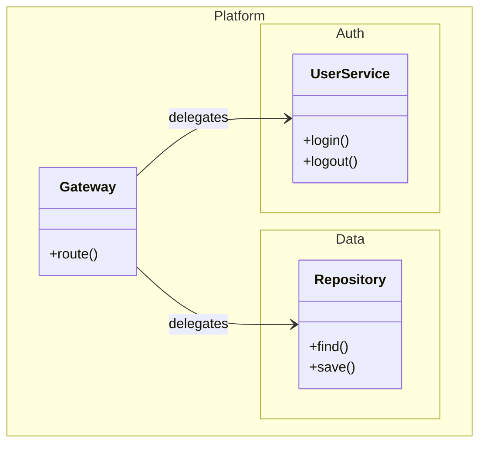
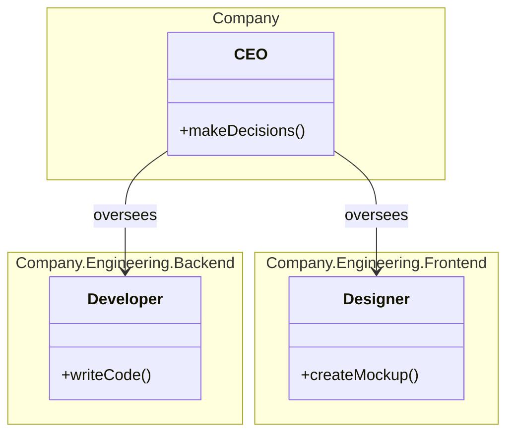

# class-namespaces

`namespace` blocks drawn as titled dashed boxes around their classes, nested and dotted as Mermaid qualifies them. Mermaid 12.3.0 official examples.

## classDiagram#17

## classDiagram#18

## classDiagram#19

## classDiagram#20

## classDiagram#21

