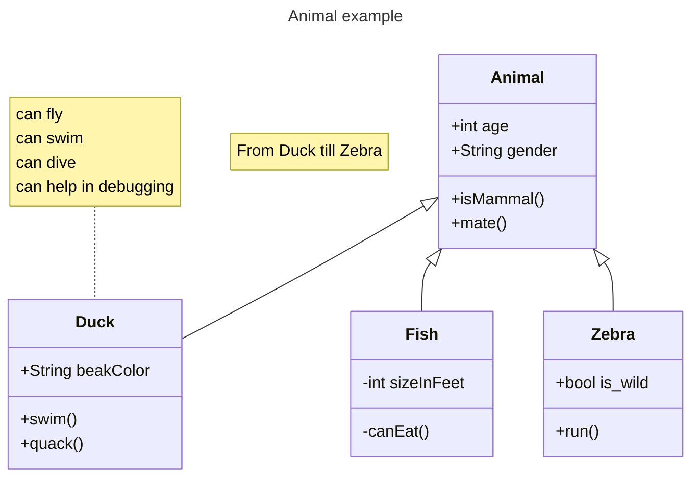
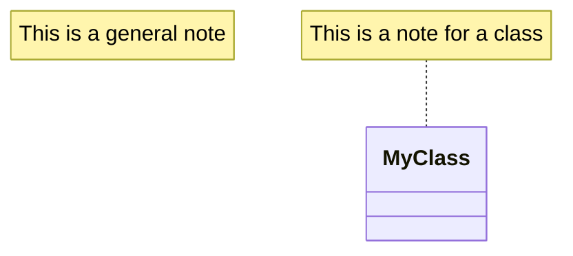

# class-notes

`note "text"` and `note for Class "text"` on class diagrams: a folded-corner note, joined to its class by a dotted line. Mermaid 12.3.0 official examples.

## classDiagram#0

## classDiagram#28

