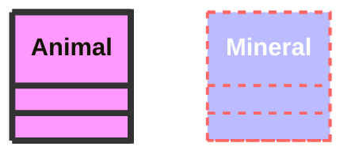
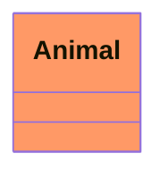
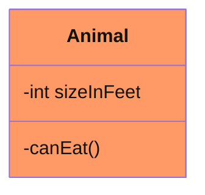
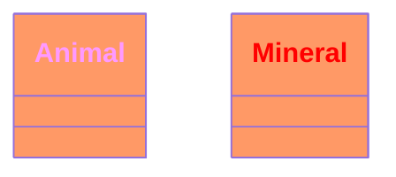
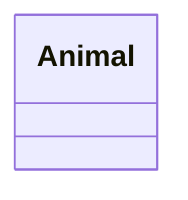
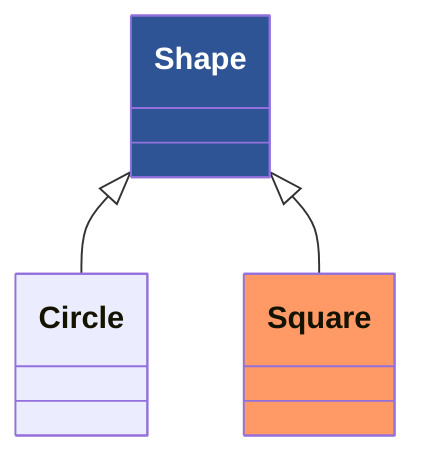

# class-styles

`style`, `classDef` with `:::` or `cssClass`, and `classDef default` on class diagrams: fill, stroke and text colour, layered as Mermaid layers them. Mermaid 12.3.0 official examples, then a styled inheritance tree (SmartArt when on).

## classDiagram#32

## classDiagram#33

## classDiagram#34

## classDiagram#35

## classDiagram#36

## Styled inheritance tree

