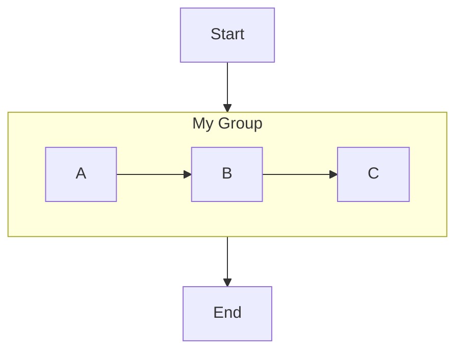
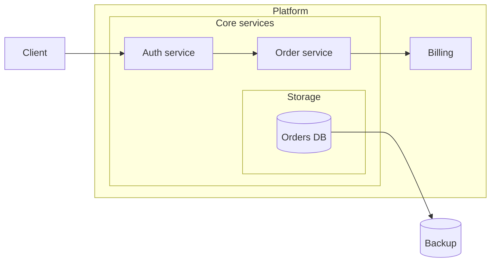
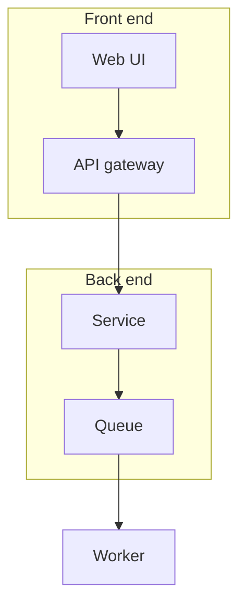

# collapsed-subgraphs

`S@{ view: collapsed }`: the subgraph is drawn folded into one box (its title, then `• • •`), its
contents hidden, links into it ending on the box, as Mermaid does. Mermaid 12.3.0 official example
flowchart#103, then cases of this project's own.

## flowchart#103: a folded group in a chain (becomes a SmartArt process when SmartArt is on)

## Links into a folded group end on the box; its parent stays open

## One group folded, its sibling open

