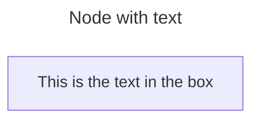
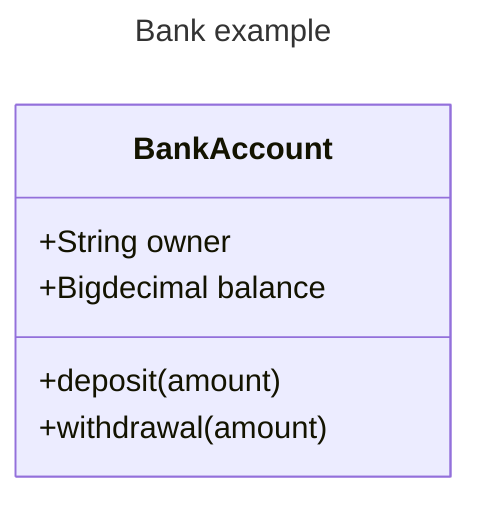
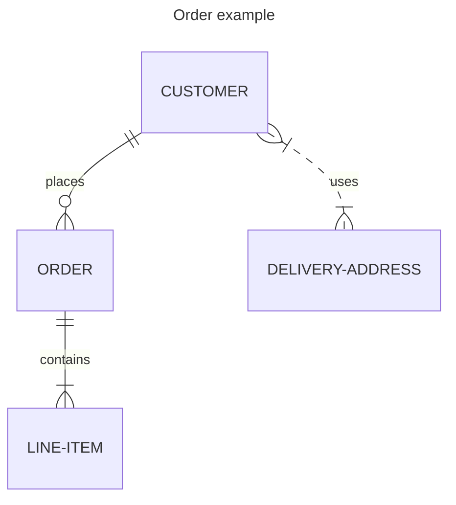
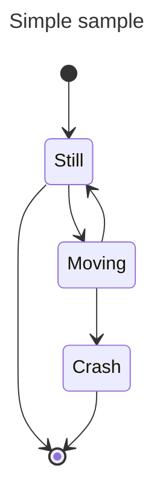

# frontmatter-titles

A frontmatter `title:` on a type with no `title` statement, drawn above the diagram as Mermaid does.
Mermaid 12.3.0 official examples.

## flowchart#1

## classDiagram#3

## entityRelationshipDiagram#0

## stateDiagram#0

