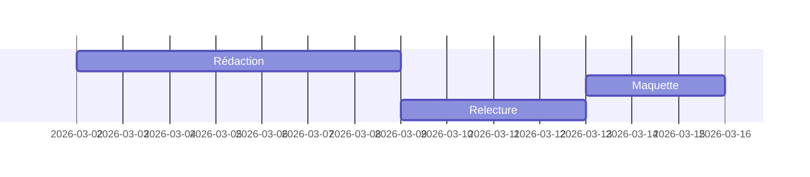
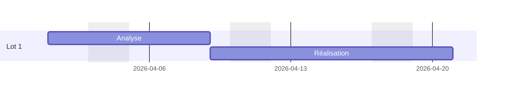
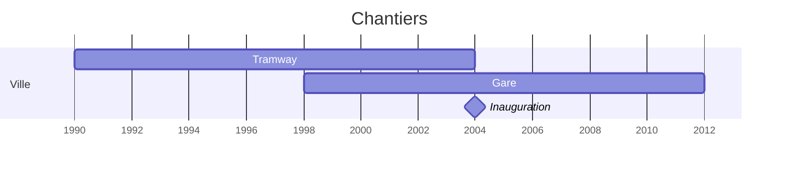

# Gantt : axe du temps, jalons, lignes verticales

Vérification des ajouts Gantt du 2026-11-21 (échelle continue, `axisFormat`, `tickInterval`, `weekday`,
`weekend friday`, `vert`, références avant, minutes et secondes, `dateFormat X`).

## 1. À la minute, jalons centrés

Le premier jalon est centré sur 17:50 (17:49 + 2 min / 2), le second sur 18:10.

```mermaid
gantt
    dateFormat HH:mm
    axisFormat %H:%M
    Ouverture : milestone, m1, 17:49, 2m
    Préparation : 10m
    Contrôle : 5m
    Clôture : milestone, m2, 18:08, 4m
```

## 2. Lignes verticales `vert`

Deux lignes bleu nuit à 09:00 et 09:40, chacune avec son libellé sous le graphique ; elles n'occupent pas de ligne.

```mermaid
gantt
    dateFormat HH:mm
    axisFormat %H:%M
    Début de séance : vert, v1, 09:00, 1m
    Exposé : 09:00, 20m
    Questions : 15m
    Fin de séance : vert, v2, 09:40, 1m
```

## 3. Références avant et `until`

« Rédaction » se termine quand « Relecture » commence, alors que « Relecture » est déclarée plus bas.

## 4. `weekend friday`, `tickInterval 1week`, `weekday monday`

Vendredis et samedis grisés et sautés ; graduations chaque lundi.

## 5. Secondes Unix (`dateFormat X`)

```mermaid
gantt
    title Durée des étapes (s)
    dateFormat X
    axisFormat %s
    section Build
    Compilation : 0, 42
    section Tests
    Unitaires : 42, 95
```

## 6. Plusieurs décennies

L'axe est gradué en années, le graphique ne dépasse pas la largeur de la page.

