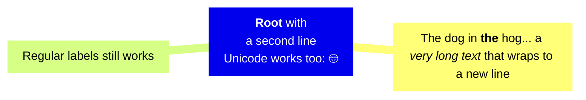
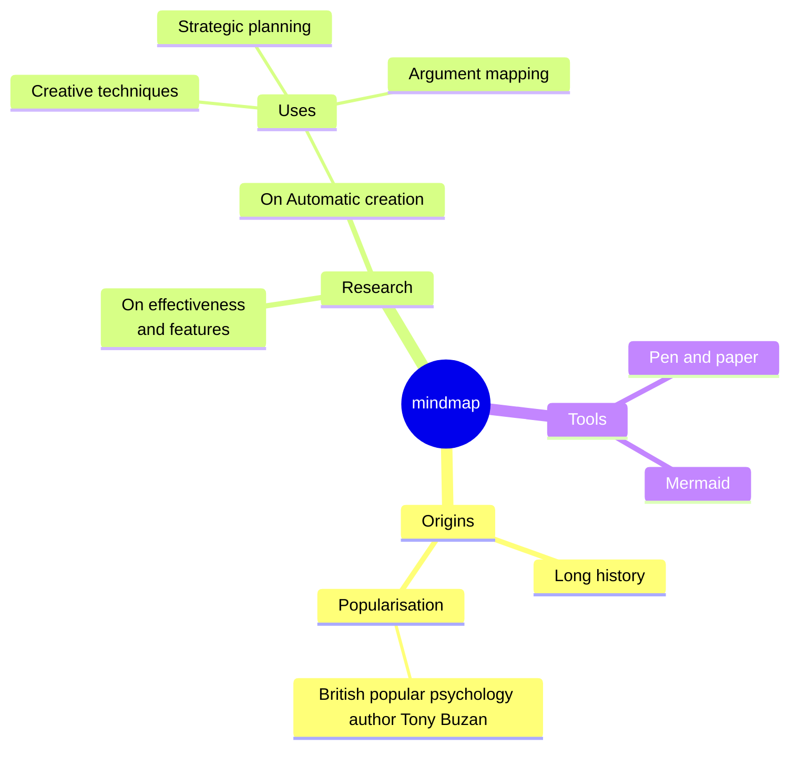
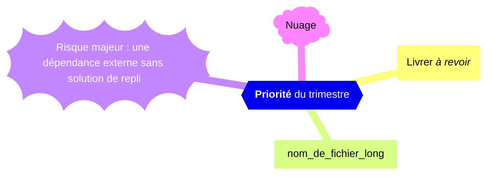

# Cartes mentales : libellés Markdown, lignes multiples, icônes

Vérification des ajouts mindmap du 2026-11-21 : tout libellé lu en Markdown (gras, italique), libellé entre
guillemets sur plusieurs lignes, ` `, retour à la ligne au-delà de 200 px, `::icon` et `:::` rattachés à
leur nœud (gardés, non dessinés, avec un avertissement). Exporté deux fois : `mindmap-labels.docx` (SmartArt,
le défaut) et `mindmap-labels-formes.docx` (`MD2NATIVEDOCX_ENABLE_SMARTART=0`, formes).

## 1. Libellé Markdown sur trois lignes (exemple officiel #14)

La racine tient sur trois lignes, « Root » en gras ; le deuxième nœud a « the » en gras et « very long text » en
italique, et passe à la ligne ; le troisième est un libellé ordinaire.

## 2. Exemple officiel #0 (icône, ` `, libellé long)

« On effectiveness / and features » sur deux lignes ; « British popular psychology author Tony Buzan » passe à
la ligne au lieu d'un nœud très large ; l'icône de « Long history » n'est pas dessinée (avertissement).

## 3. Markdown sans guillemets, formes, tiret bas dans un mot

« Priorité » en gras, « à revoir » en italique ; `nom_de_fichier_long` reste écrit tel quel.

