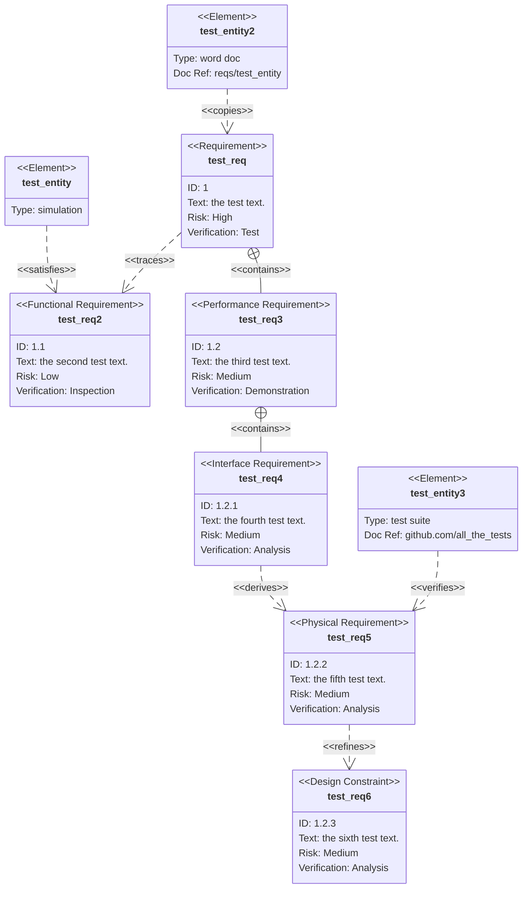
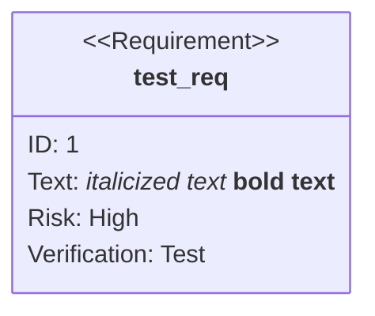
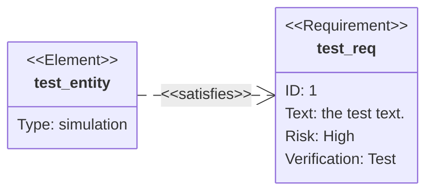
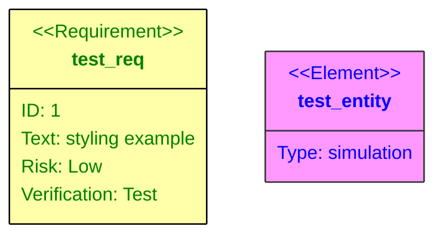
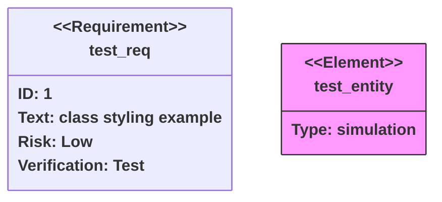
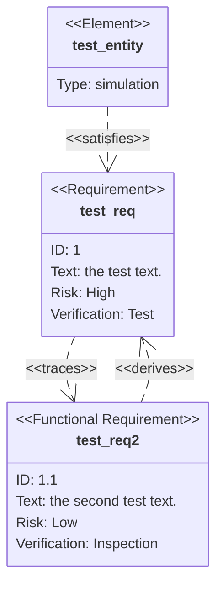

# Diagrammes d'exigences : lecture et dessin comme Mermaid

Vérification de la reprise du 2026-11-21 : grammaire de Mermaid (noms et valeurs entre guillemets, noms avec
espaces, `:::`), boîtes dessinées comme `requirementBox` de Mermaid (stéréotype puis nom en gras, puis `ID:`,
`Text:`, `Risk:`, `Verification:` ou `Type:`, `Doc Ref:`, centrés), Markdown dans les boîtes, `contains` en
trait plein avec un cercle barré d'une croix côté contenant, les six autres en pointillés avec une flèche
ouverte, `direction`, `style`, `classDef`, `class`.

## 1. Tous les types et toutes les relations (exemple officiel #4)

Six exigences, trois éléments. `test_req` contient `test_req3`, qui contient `test_req4` : deux traits pleins
avec le cercle barré côté `test_req` et côté `test_req3`. Les autres liens en pointillés, flèche ouverte côté
destination. `test_entity3` est de type « test suite », sans guillemets.

## 2. Markdown dans une boîte (exemple officiel #3)

Le nom « test_req » en gras, sans les soulignés ; « italicized text » en italique, « bold text » en gras, après
« Text: ».

## 3. De gauche à droite (exemple officiel #5)

L'élément à gauche, l'exigence à droite, sur une même ligne.

## 4. `style` (exemple officiel #6)

L'exigence en jaune pâle, bordure noire, texte vert ; l'élément en rose, bordure gris foncé, texte bleu.

## 5. Classes (exemple officiel #8)

Les deux boîtes ont tout leur texte en gras (`font-weight:bold` de la classe `important`) ; l'élément est en
rose, bordure gris foncé.

## 6. Deux relations entre les mêmes boîtes (cas de vérification d'origine)

`test_req` trace vers `test_req2` et `test_req2` dérive de `test_req`, en sens opposés : deux lignes écartées,
deux libellés lisibles, aucun caché par le fond blanc de l'autre.

