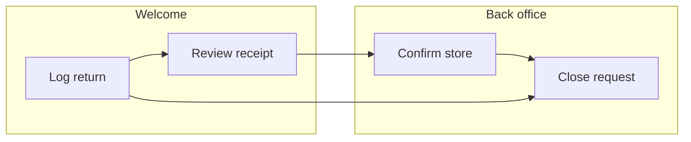
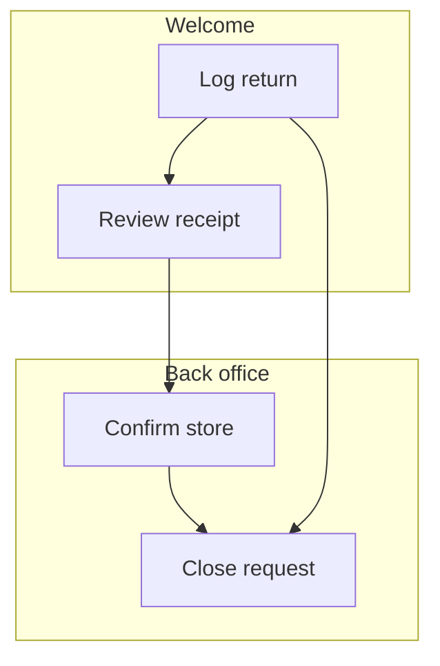
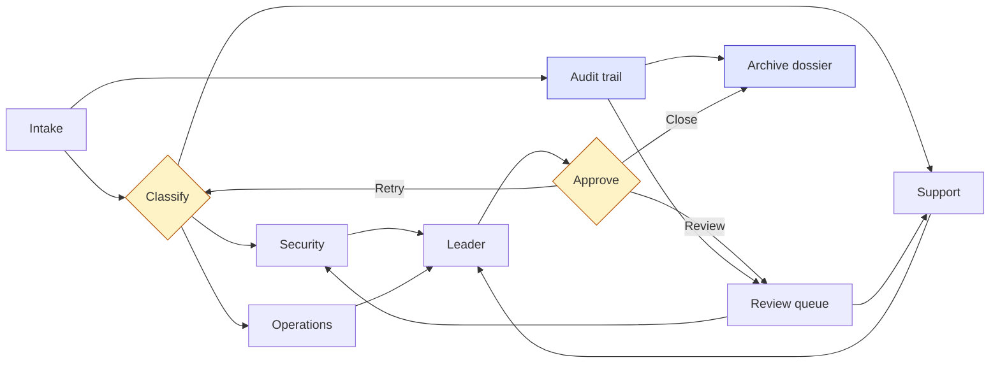

# Connecteurs routés autour d'un nœud

Chaque flèche qui contourne un nœud est un connecteur coudé de Word, attaché à ses deux formes.

## Raccourci entre deux sous-graphes, de gauche à droite (cas F02 du banc)

## Le même, de haut en bas

## Plusieurs détours, dont un retour en arrière (cas S03 du banc)

