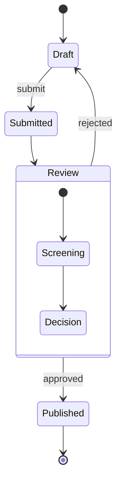
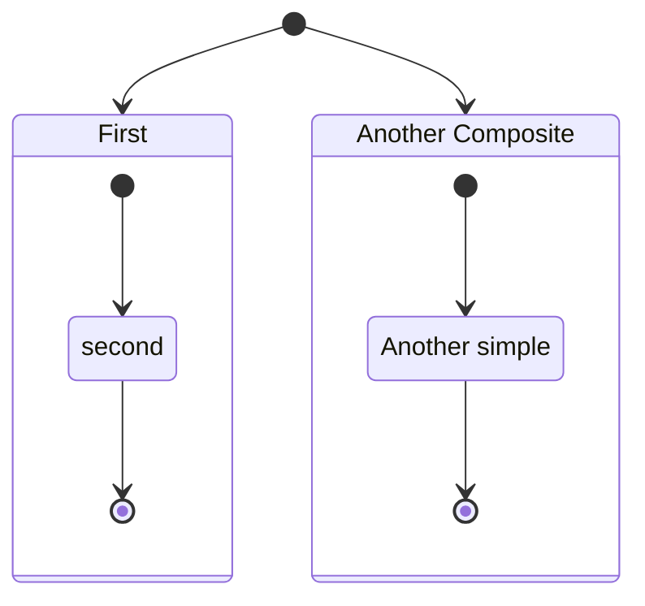
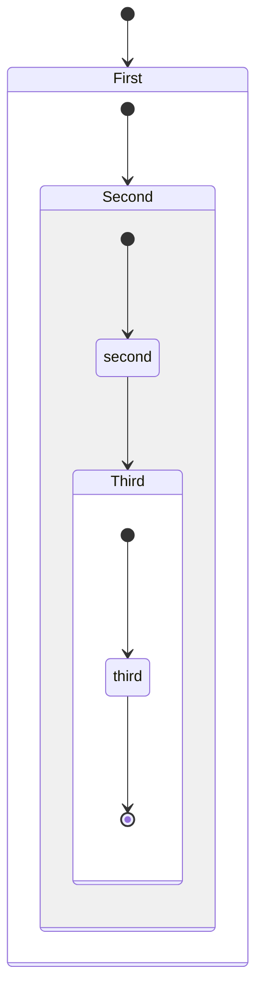
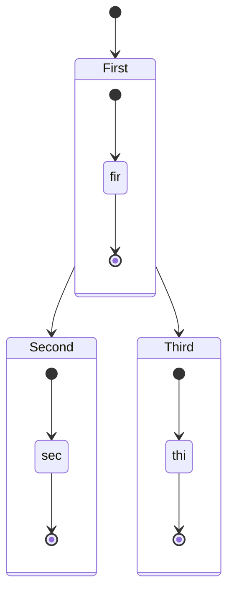
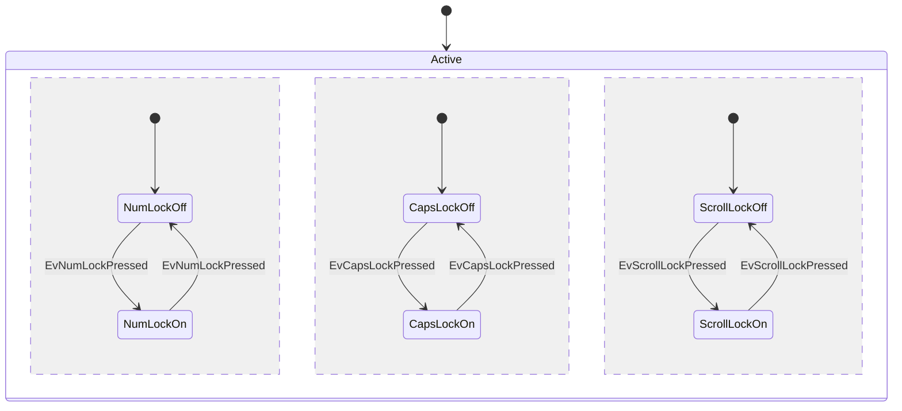
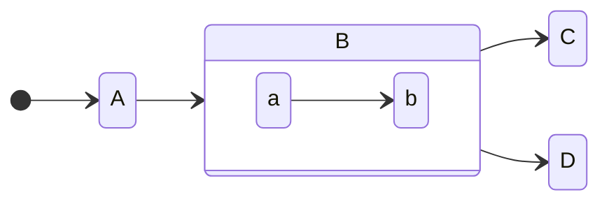
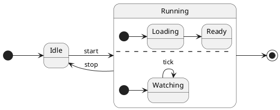

# state-composites

Composite states drawn as nested boxes, their concurrent regions side by side, one `[*]` start and end per block. Mermaid 12.3.0 official examples, then a PlantUML composite.

## stateDiagram#2

## stateDiagram#10

## stateDiagram#11

## stateDiagram#12

## stateDiagram#16

## stateDiagram#17

## PlantUML composite with regions (left to right)

