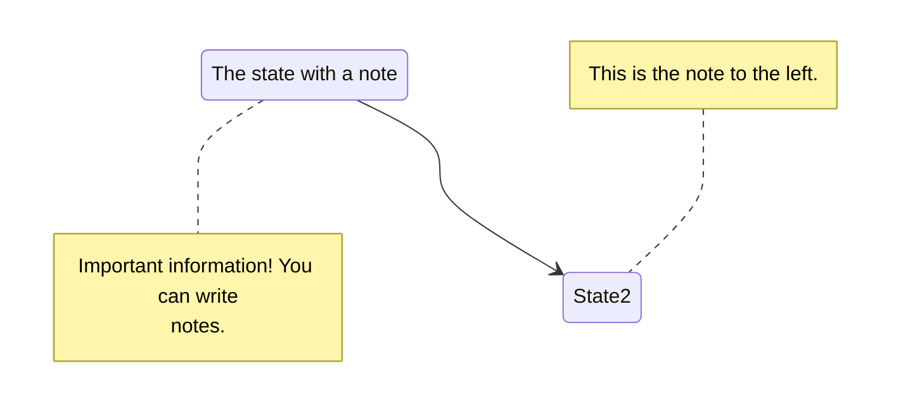
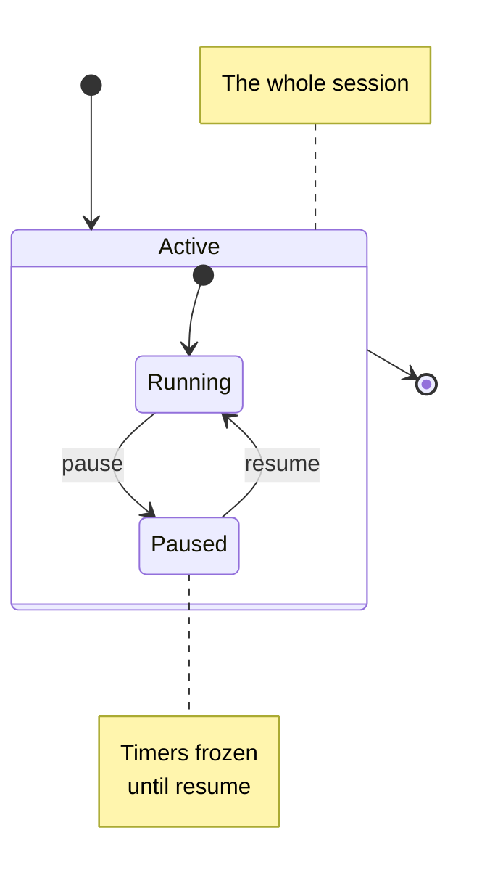
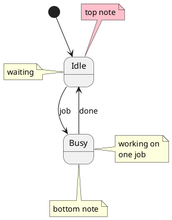
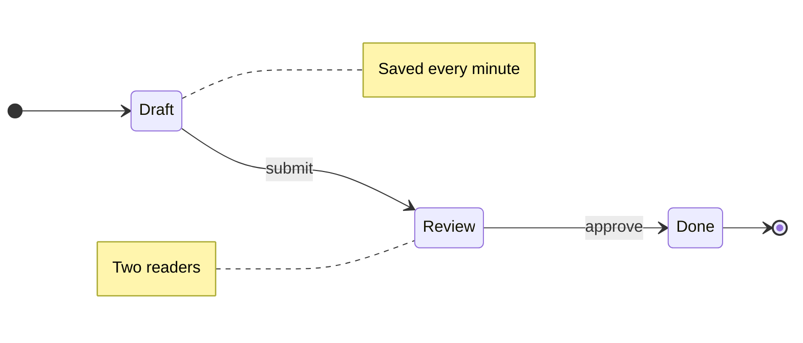

# state-notes

Notes beside their state, folded corner, joined by a dotted line. Mermaid 12.3.0 official example #15, a note inside a composite, then PlantUML notes on four sides.

## stateDiagram#15

## A note inside a composite

## PlantUML notes on four sides

## Notes in a left-to-right diagram

