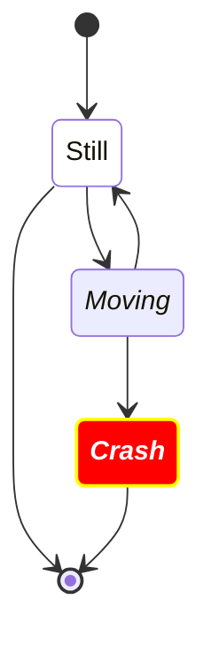
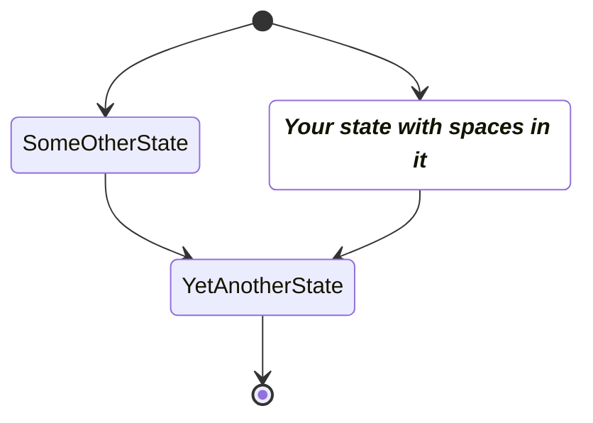
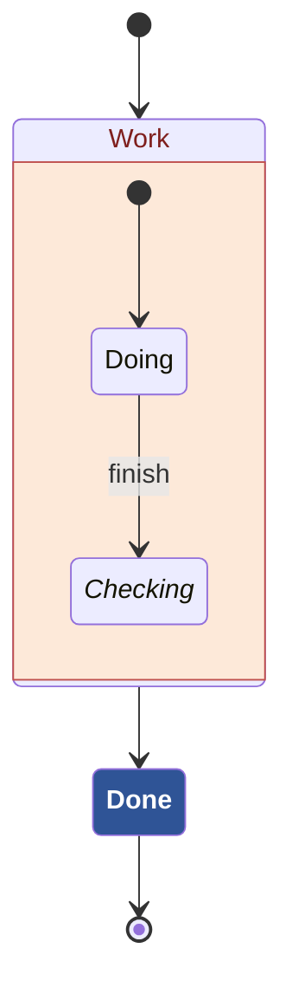

# state-styles

`classDef` given through `class` or `:::`, and `style`: fill, border, text colour, bold, italic. Mermaid 12.3.0 official examples #19 to #21, then a styled composite. Colours may be hex or CSS names (`white`, `yellow` in #19).

## stateDiagram#19

## stateDiagram#20

## stateDiagram#21

## A styled composite

