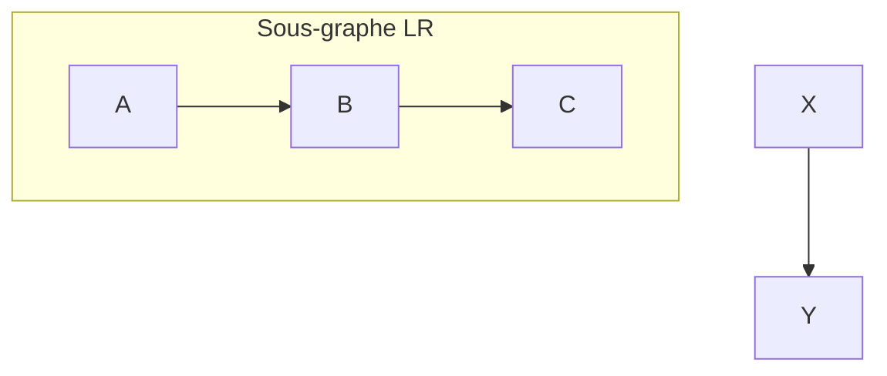
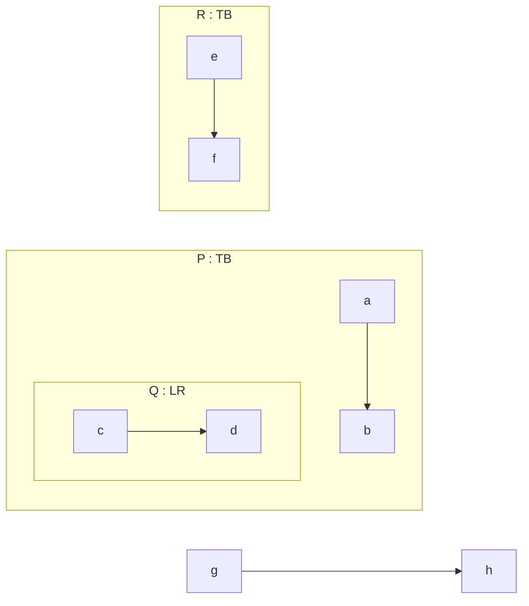
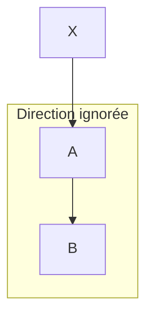

# R2.4 — direction dans un subgraph

## Cas 1 : sous-graphe isolé, LR dans un flowchart TD

## Cas 2 : sous-graphes imbriqués, directions alternées

## Cas 3 : lien traversant la frontière (direction ignorée, avertissement attendu)

