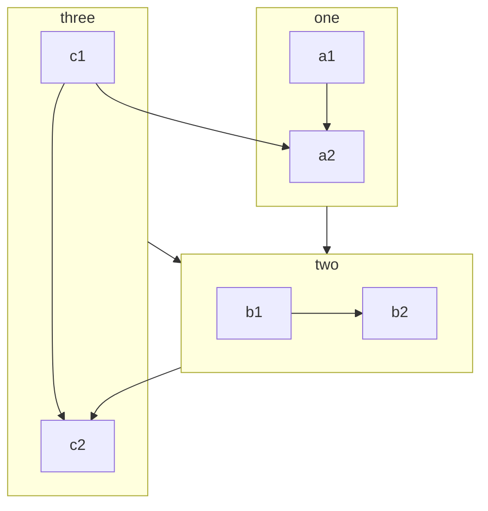
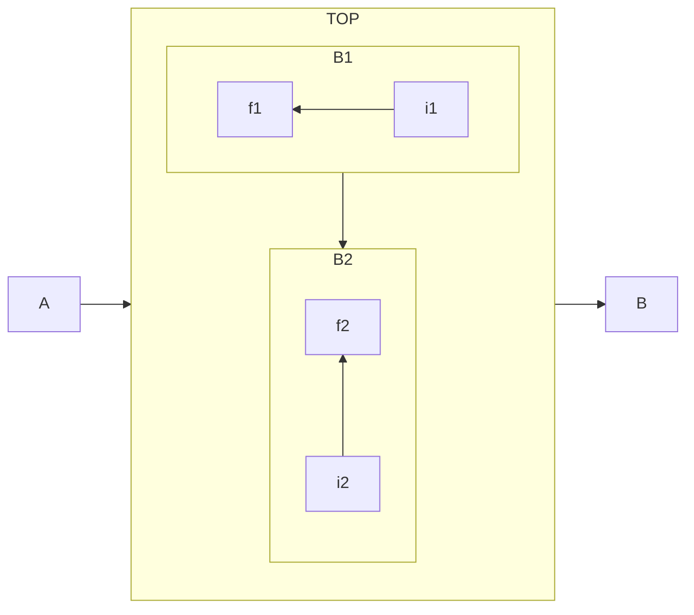
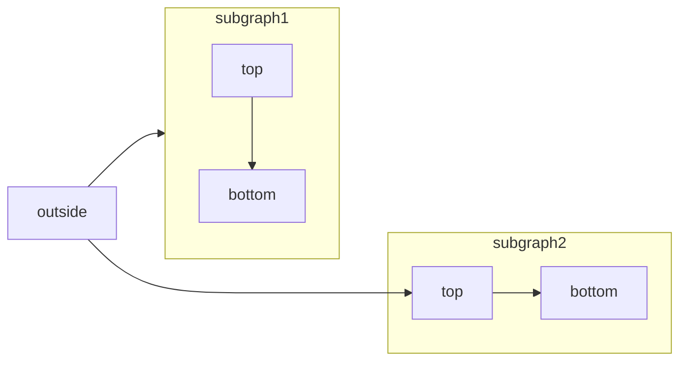
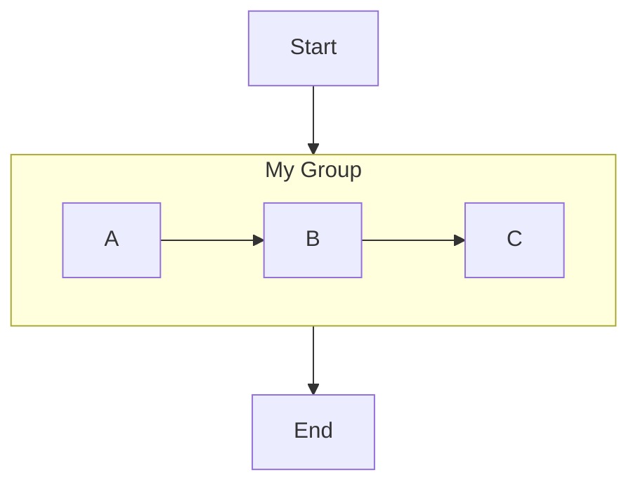
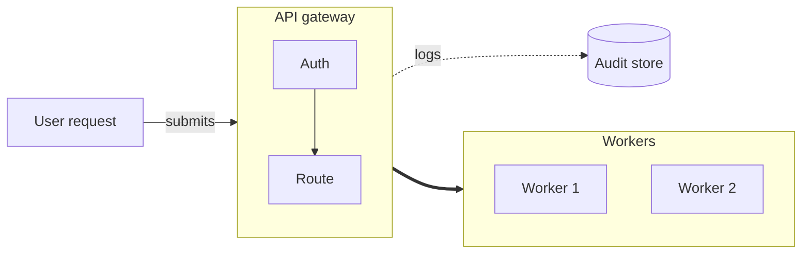
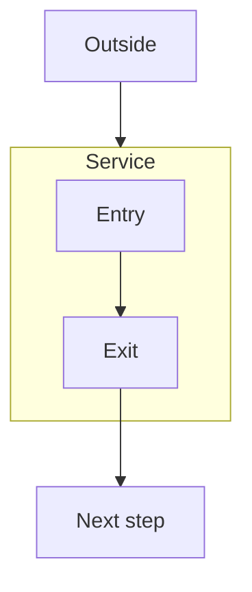

# subgraph-links

Links to a subgraph (`A --> S`), drawn to the subgraph's border as Mermaid does. Mermaid 12.3.0 official
examples (docs/syntax/flowchart.md, flowchart#100 to #103), then a few cases of this project's own.

## flowchart#100: links between subgraphs

## flowchart#101: nested subgraphs, each with its own direction

## flowchart#102: a link to a subgraph keeps its direction, a link inside does not

## flowchart#103: in and out of a titled subgraph (collapsed view drawn open)

## Labelled and dotted links, left to right

## A link that crosses the border: ranked against the first node

