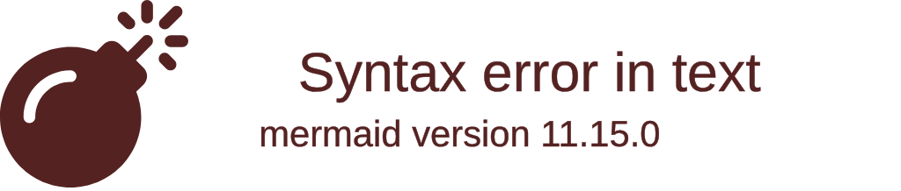

# Arborescences (`treeView-beta`) : lecture et dessin comme Mermaid

Vérification de la reprise du 2026-11-21 : grammaire de Mermaid (`treeView.langium` et sa lecture des
arbres en traits `├──`), racine implicite `/` au-dessus des entrées comme dans le rendu de Mermaid, dossiers
en gras sans leur `/` final, descriptions en italique vert alignées dans une colonne, ligne `highlight` sur
une bande ambre jusqu'au bord droit, traits noirs, `title`.

Par défaut (SmartArt activée), chaque arbre est une hiérarchie SmartArt dont la boîte du haut est `/`. Le
rendu en formes (`MD2NATIVEDOCX_ENABLE_SMARTART=0`, `tree-view-shapes.docx`) est celui qui ressemble à
Mermaid ligne pour ligne.

## 1. Le cas d'origine (2026-10-02)

Deux entrées de premier niveau, `packages` et `docs`, sous `/`. `index.ts` est surligné : la syntaxe a été
corrigée en `index.ts :::highlight` (avec une espace, comme le veut la grammaire de Mermaid : sans espace,
`index.ts:::highlight` est un nom de fichier).

## 2. Arbre en traits (exemple officiel #2)

Les traits `├──`, `│`, `└──` disparaissent : le niveau vient de la colonne de chaque branche. `packages`
contient `mermaid` et `parser`, `README.md` est au premier niveau.

## 3. Descriptions en colonne et surlignage (exemple officiel #9, sans l'icône)

Les trois descriptions commencent à la même abscisse, à droite du nom le plus long. La bande de `App.tsx`
va jusqu'au bord droit de l'arbre, descriptions comprises.

## 4. Titre et guillemets simples

Le titre « Mon dépôt » est un paragraphe en gras au-dessus de l'arbre. `'mes documents/'` est un dossier,
affiché `mes documents`.

## 5. Icônes (avertissement, pas de dessin)

`icon(none)` ne produit rien ; `icon(logos:react)` est signalé dans le journal (les icônes viennent de
paquets que la page web de Mermaid enregistre). Le nom reste affiché, sans place réservée pour l'icône.

## 6. Caractères spéciaux

Les noms et descriptions s'affichent tels quels : `<b>&'`, `a & b`.

